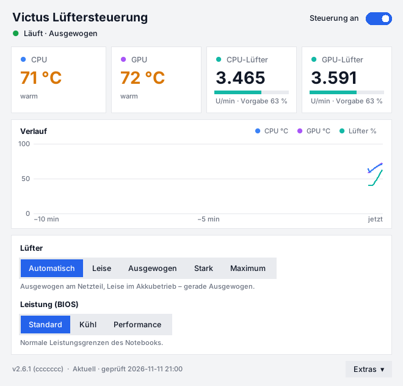

# HP Victus – intelligente Lüftersteuerung

Hintergrunddienst für HP-Victus-Notebooks (entwickelt für das **HP Victus BV8D4EA#ABD**
unter **Windows 11**). Er ersetzt die oft hektische oder zu laute Standardregelung durch
eine ruhige, vorausschauende Lüfterkurve und läuft unsichtbar ab dem Systemstart.

## Was macht die Steuerung „intelligent“?

| Funktion | Wirkung |
|---|---|
| **CPU + GPU gemeinsam** | Beide Lüfter folgen dem höheren Bedarf – CPU und GPU teilen sich die Heatpipes. |
| **Asymmetrische Glättung** | Steigende Temperaturen werden schnell erkannt, kurze Lastspitzen (z. B. Browser-Tab öffnen) lösen aber kein Aufheulen aus. |
| **Hysterese** | Heruntergeregelt wird erst, wenn es mindestens 4 °C kühler ist – kein ständiges Auf und Ab. |
| **Verzögertes Abschalten** | Der niedrigere Bedarf muss 20 s anliegen, bevor die Lüfter langsamer werden. |
| **Rampen** | Schnell hoch (15 %/s), sanft runter (3 %/s) – Drehzahländerungen sind kaum hörbar. |
| **Netz/Akku-Erkennung** | Im Akkubetrieb automatisch das leise Profil. |
| **Profile** | `quiet`, `balanced`, `performance` + eigene Kurven, jederzeit umschaltbar. |
| **Sicherheit** | Ab 92 °C oder ohne Sensordaten sofort volle Drehzahl; nach wiederholten Fehlern übernimmt wieder das BIOS. |

Kann das BIOS deines Geräts keine stufenlosen Drehzahlen, schaltet die Steuerung
automatisch in den **Max-Modus**: BIOS-Automatik im Normalbetrieb, volle Drehzahl ab
hohem Bedarf (mit Hysterese, damit nicht ständig umgeschaltet wird).

## Installation (Windows 11)

1. Repository herunterladen (grüner Button **Code → Download ZIP**) und entpacken.
2. **OMEN Gaming Hub** schließen bzw. dessen Lüftereinstellungen nicht parallel nutzen –
   beide Programme würden sich sonst gegenseitig überschreiben.
3. Doppelklick auf **`install\windows\install.cmd`** und die Administrator-Abfrage bestätigen.

Der Installer

- installiert bei Bedarf Python 3.12 (über `winget`),
- legt alles unter `C:\Program Files\VictusFan` ab,
- prüft mit `victus-fan diagnose`, ob die HP-BIOS-Schnittstelle erreichbar ist
  (bei einem Fehler wird **nichts** eingerichtet),
- richtet die geplante Aufgabe **VictusFanControl** ein: startet mit Windows,
  läuft ohne Fenster als SYSTEM, startet sich bei einem Absturz neu,
- richtet das Tray-Icon für alle Benutzer im Autostart und im Startmenü ein.

Für ein Update einfach die neue Version herunterladen und `install.cmd` erneut ausführen –
deine `config.toml` bleibt erhalten.

## Automatische Updates

Neue Versionen werden automatisch installiert – du musst nichts mehr herunterladen.

- Die geplante Aufgabe **VictusFanUpdate** prüft 10 Minuten nach dem Systemstart und danach
  alle 6 Stunden, ob es auf GitHub einen neueren Stand gibt (Standard-Branch von
  [`Exc3pt10n/hp-victus-fan-control`](https://github.com/Exc3pt10n/hp-victus-fan-control)).
- Gibt es einen, lädt sie ihn herunter und führt dessen Installer unbeaufsichtigt aus.
  Deine `config.toml` bleibt erhalten, die Lüftersteuerung wird danach sofort wieder
  gestartet – auch wenn das Update fehlschlägt.
- Das Tray-Icon bemerkt das Update und startet sich selbst mit der neuen Version neu.
- Version und Update-Status stehen unten im Fenster; dort und im Tray-Menü gibt es
  **Nach Updates suchen** (fragt nach Administratorrechten).

```bash
victus-fan update --check
```

| Einstellung in `[update]` | Wirkung |
|---|---|
| `enabled = false` | Auto-Update abschalten |
| `check_only = true` | Nur anzeigen, dass es ein Update gibt, nicht installieren |
| `branch = "..."` | Anderen Branch verfolgen (leer = Standard-Branch) |

Log der Updates: `C:\ProgramData\VictusFan\update.log`, Ausgabe des Installers:
`update-install.log` im selben Ordner.

> **Wichtig:** Das Update läuft mit SYSTEM-Rechten und installiert, was auf dem verfolgten
> Branch liegt. Wer in das Repository pushen darf, kann damit Code auf deinem Notebook
> ausführen. Halte den Schreibzugriff auf das Repository daher auf dich beschränkt.

## Oberfläche und Tray-Icon



Nach der Installation erscheint unten rechts in der Taskleiste (ggf. hinter dem `^`) ein
Icon mit der **höchsten aktuellen Temperatur** (CPU oder GPU):


Grün unter 70 °C · Orange ab 70 °C · Rot ab 85 °C · Grau = pausiert · Lüftersymbol = Dienst läuft nicht.
Fährt man mit der Maus darüber, zeigt der Tooltip CPU, GPU und Lüfter einzeln.

- **Klick** öffnet das Fenster: aktuelle Werte, Verlauf der letzten 10 Minuten,
  Profil- und Modusauswahl. Schließen (✕) blendet es nur aus.
- **Rechtsklick** öffnet das Menü: Profil, Modus, Konfiguration, Log, Dienst neu starten.
- Das Tray-Icon startet bei jeder Anmeldung automatisch; außerdem gibt es einen Eintrag
  **Victus Lüftersteuerung** im Startmenü.

Die Profile sind auf die gemessenen Drehzahlen des Victus BV8D4EA abgestimmt
(20 % ≈ 1100 U/min, leiser als die BIOS-Automatik im Leerlauf; 100 % ≈ 5400 U/min):

| Profil | Verhalten |
|---|---|
| **Leise** | Lüfter stehen unter 50 °C still, danach sanfter Anstieg (Standard im Akkubetrieb) |
| **Ausgewogen** | Mindestens 20 %, steigt ab 50 °C (Standard im Netzbetrieb) |
| **Leistung** | Mindestens 30 %, steigt früher und steiler |

| Modus | Bedeutung |
|---|---|
| **Intelligent** | Normale Regelung nach Profil und Kurve |
| **Volle Drehzahl** | Lüfter dauerhaft auf Maximum (z. B. beim Rendern) |
| **Pause (BIOS)** | Steuerung ruht, das BIOS regelt wie ab Werk |

Die Oberfläche läuft mit normalen Benutzerrechten. Mit der Hardware spricht nur der
Hintergrunddienst; die Oberfläche liest dessen Status und schreibt nur deine Auswahl.
Beendest du das Tray-Icon, regelt der Dienst unverändert weiter.

## Kommandozeile

In einer neuen Eingabeaufforderung oder PowerShell:

```bash
victus-fan status
```

```bash
victus-fan profile quiet
```

Profile: `quiet`, `balanced`, `performance` oder `auto` (= automatisch nach Netz/Akku).

```bash
victus-fan mode max
```

Modi: `normal`, `max`, `paused`.

```bash
victus-fan curve balanced
```

| Datei | Zweck |
|---|---|
| `C:\ProgramData\VictusFan\config.toml` | Konfiguration (Kurven, Hysterese, Profile …) – Änderungen gelten nach dem Speichern sofort |
| `C:\ProgramData\VictusFan\victus-fan.log` | Log |
| `install\windows\restart-service.cmd` | Dienst neu starten |
| `install\windows\uninstall.cmd` | Alles entfernen, Lüfter zurück ans BIOS |

Alle Einstellungen sind in [`config.example.toml`](config.example.toml) kommentiert. Eigene
Profile legst du als `[profiles.name]` mit `cpu_curve`/`gpu_curve` an; sie erscheinen
automatisch in der Oberfläche. Eine fehlerhafte Konfiguration wird ignoriert (siehe Log),
die bisherige bleibt aktiv.

## Hardware-Test – bei Problemen zuerst ausführen

Nicht jedes Victus-BIOS setzt alle Befehle um: Manche Modelle **bestätigen** eine feste
Drehzahl, ignorieren sie aber. Die Steuerung vergleicht deshalb laufend die gemessene
Drehzahl mit ihrer Vorgabe und zeigt im Fenster eine Warnung, wenn die Lüfter nicht folgen.

Der **Hardware-Test** (Button im Fenster oder Tray-Menü, Adminrechte nötig) prüft in etwa
zwei Minuten, was dein Gerät wirklich kann:

1. Drehzahl in der BIOS-Automatik messen
2. Max-Lüfter einschalten und messen (ergibt auch die echte Maximaldrehzahl)
3. Feste Drehzahl hoch und niedrig vorgeben und messen
4. In den BIOS-Leistungsmodi `default`, `cool` und `performance` jeweils prüfen, ob feste
   Drehzahlen wirken. Beim Victus BV8D4EA ignoriert das BIOS sie direkt nach dem
   Systemstart, setzt sie aber um, sobald einmal ein Leistungsmodus gesetzt wurde –
   `default` genügt dafür und verändert die Leistungsaufnahme nicht (`performance` erlaubt
   mehr Leistung = mehr Wärme).
5. Niedrige Stufen prüfen: Hebt das BIOS sie an (`min_level`) und stehen die Lüfter bei 0 still?

Danach wird der BIOS-Leistungsmodus auf `default` zurückgesetzt; die Steuerung setzt den
ermittelten Modus selbst, solange sie läuft. Im Modus **Pause** und beim Beenden stellt sie
ihn wieder auf Standard.

Folgen die Lüfter im Betrieb trotzdem einmal nicht, probiert die Steuerung selbst den
nächsten Modus (`default` → `cool` → `performance`) und merkt sich den funktionierenden.

Das Ergebnis wird automatisch in die `config.toml` übernommen (`[windows] mode` und
Maximalstufen), der Dienst stellt sich ohne Neustart darauf ein. Ignoriert das BIOS feste
Drehzahlen, schaltet die Steuerung zwischen BIOS-Automatik und Max-Lüfter um; Max bleibt
dabei mindestens 60 s an (`[toggle] min_on_time`), damit die Lüfter nicht „pumpen“. Per
Kommandozeile als Administrator:

```bash
victus-fan selftest --apply
```

Funktioniert danach immer noch etwas nicht, schick mir bitte die Zeile **„Rohdaten“** am Ende
der Testausgabe.

## Erster Test – bitte einmal durchführen

Ich konnte die Steuerung nicht auf echter Victus-Hardware testen. Die BIOS-Befehle
(`hpqBIntM`, Befehl `0x20008`: Temperatur `0x23`, Lüfterstufe `0x2D`/`0x2E`, Max-Lüfter
`0x27`) stammen aus der öffentlichen Community-Dokumentation zu HP-OMEN-/Victus-Geräten
(z. B. OmenMon). Deshalb:

1. Nach der Installation `victus-fan status` aufrufen – Temperaturen und Drehzahlen sollten
   plausibel sein.
2. Last erzeugen (Spiel, Benchmark) und beobachten, ob die Drehzahl steigt.
3. Für einen Testlauf ohne Eingriff (als Administrator):

```bash
victus-fan run --dry-run -v
```

4. Die maximalen Lüfterstufen (`max_level_cpu`/`max_level_gpu`, in 100 U/min) bei Bedarf an
   die Drehzahlen anpassen, die `status` unter Volllast im Max-Modus zeigt.

Wenn etwas nicht stimmt: `install\windows\uninstall.cmd` gibt die Lüfter sofort ans BIOS
zurück. Das BIOS übernimmt außerdem selbst nach ca. 2 Minuten ohne Befehl wieder die
Automatik, und seine eigene Überhitzungsabschaltung bleibt immer aktiv.

## Linux (optional)

Für Linux mit dem Kernel-Treiber `hp-wmi` gibt es ein zweites Backend und einen
systemd-Dienst: `sudo install/linux/install.sh`. Neuere Kernel unterstützen bei manchen
Victus-Modellen stufenlose Steuerung (`pwm1`), sonst wird zwischen Automatik und Max
umgeschaltet.

## Entwicklung

```bash
python -m unittest -v
```

```bash
python -m victus_fan -c config.example.toml run --backend simulate -v
```

Die Oberfläche benötigt `pip install .[gui]` (unter Windows automatisch enthalten).

```bash
python -m victus_fan -c config.example.toml gui
```

Aufbau: `victus_fan/controller.py` (Regelkern, hardwareunabhängig und getestet),
`victus_fan/service.py` (Dienstschleife), `victus_fan/backends/` (Windows-BIOS, Linux, Simulation),
`victus_fan/gui.py` (Tray-Icon und Fenster), `victus_fan/state.py` (Austausch Dienst ↔ Oberfläche).

Lizenz: MIT
